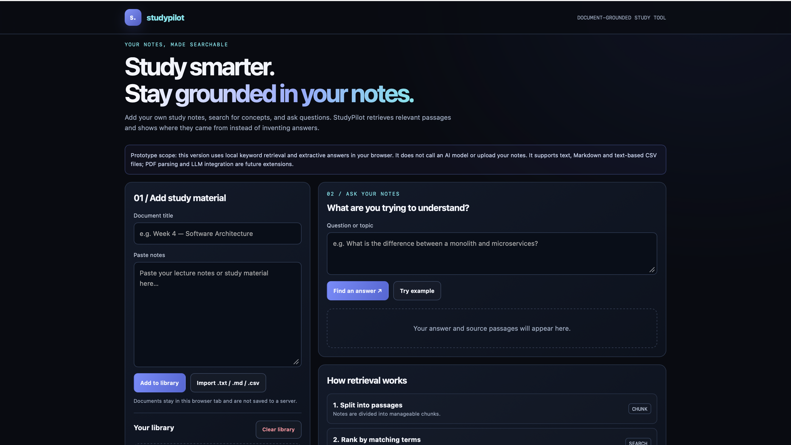

# StudyPilot — Document-Grounded Study Assistant

> Search your own study notes and inspect the passages that support a result.

**Live demo:** [https://khare-pratham.github.io/studypilot/](https://khare-pratham.github.io/studypilot/)

## Overview

StudyPilot is a local-first study prototype. Users can paste notes or import text-based files, ask a question, and retrieve matching passages with document titles. It reports when no relevant evidence is found rather than generating an unsupported answer.

## Features

- Add notes by pasting text and giving the document a title
- Import text, Markdown and text-based CSV files
- Split documents into manageable passages
- Rank passages using keyword overlap
- Display matching source passages and document titles
- Return a no-match message when no passage has matching keywords
- Process notes in the browser without uploading them to a server

## Tech stack

`HTML5` · `CSS3` · `Vanilla JavaScript` · `Browser File API` · `Keyword-based retrieval`

## How it works

The app stores documents in in-memory JavaScript state for the current page session. It splits notes into passages, tokenises the question and passage text, scores passages using keyword overlap and an exact-phrase bonus, and renders the best matching evidence. It does not call an AI model or upload documents.

## Run locally

1. Clone or download this repository.
2. Open `index.html` in a browser.

If local-file restrictions interfere, run this from the project folder:

```bash
python3 -m http.server 8000
```

Then visit `http://localhost:8000`.

## Test checklist

- [ ] Add notes and confirm the document appears in the library
- [ ] Import a .txt or .md file and confirm its content can be searched
- [ ] Ask a question using terms present in notes and inspect the retrieved passage
- [ ] Ask an unrelated question and confirm a no-match message
- [ ] Remove a document and verify it is no longer searchable
- [ ] Clear the library and verify documents are removed from the session

## Known limitations

- Keyword retrieval only; paraphrases and semantic matches can be missed
- Results are retrieved excerpts, not generated explanations or verified answers
- No LLM, embeddings, semantic search, PDF parsing or cross-document reasoning
- Documents are held in page-session memory and are lost on refresh
- Large-file support is intentionally limited

## Potential improvements

- Add automated tests for tokenisation, ranking and no-match behaviour
- Improve retrieval scoring and handle common word variants
- Add PDF text extraction with clear user-facing limits
- Evaluate semantic retrieval and LLM integration with source-grounding tests

## Screenshots



## Project status

Portfolio prototype. This README distinguishes implemented features from potential future improvements.
